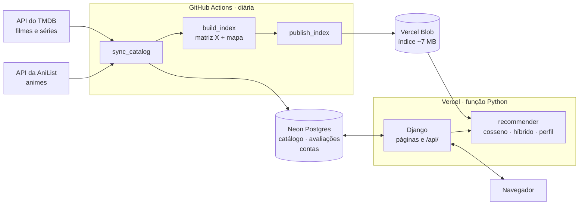
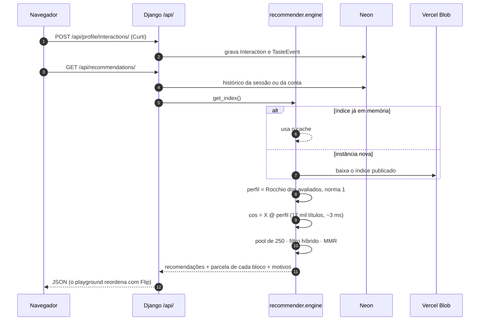
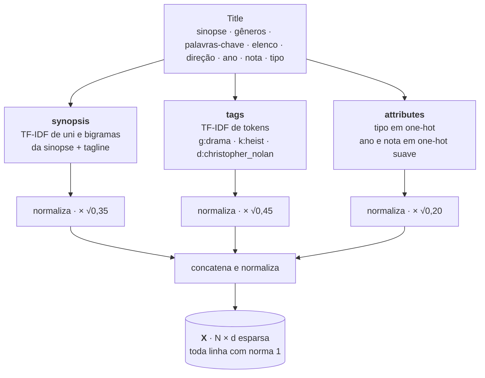
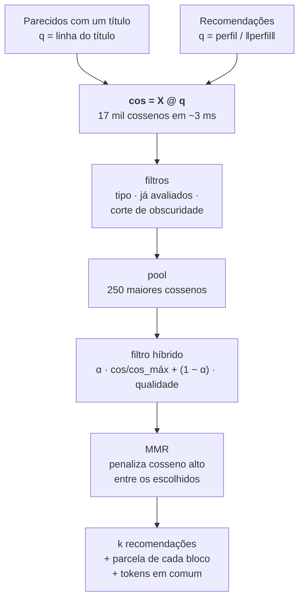

# Ângulo — recomendação de filmes, séries e animes

Plataforma de recomendação baseada em **similaridade do cosseno**, com **filtro híbrido**
(semelhança + qualidade) e **perfil de usuário dinâmico**. Backend em Django + scikit-learn;
front-end em Tailwind CSS v4, GSAP (ScrollTrigger, SplitText, Flip) e um shader WebGL que
desenha o fundo em caracteres ASCII.

- **Página inicial**: hero com o campo WebGL reagindo ao cursor e à rolagem, e uma seção que
  explica o cálculo passo a passo enquanto a fórmula e as tintas do fundo mudam com o scroll.
- **Playground** (`/playground/`): marque "Curti" / "Não curti" no catálogo e veja as
  recomendações, o "DNA" do seu perfil e a matriz de similaridade se recalcularem a cada clique.
  Controles para α (similaridade × qualidade), nota × popularidade, corte de títulos pouco
  votados, diversidade (MMR) e tipos.

Como o cosseno é calculado e onde ele entra no código: [Similaridade do cosseno](#similaridade-do-cosseno-onde-e-como).

## Arquitetura



- **Rotina diária** (GitHub Actions): traz o catálogo das APIs para o Neon, constrói a matriz de
  features e o mapa e publica o índice pronto no Vercel Blob (detalhes em
  [Rotina diária](#rotina-diária-github-actions)).
- **Vercel**: o Django serve as páginas e a API. O índice não é construído lá, só baixado: cada
  instância nova pega o arquivo do Blob uma vez e o guarda em memória e em `/tmp`.
- **Neon**: guarda o catálogo, as avaliações (`Interaction`, `TasteEvent`), as contas, as
  preferências e o registro das publicações do índice (`IndexSnapshot`).

Uma avaliação no playground, do clique às recomendações novas:



## Como executar

Requer Python 3.11+. No Windows (PowerShell), a partir da raiz do repositório:

```powershell
python -m venv .venv
.venv\Scripts\activate
pip install -r requirements.txt

cd Django\recomendador_filmes
python manage.py migrate
python manage.py import_dataset     # ~10 s: importa os CSVs de data/ e constrói o índice
python manage.py runserver
```

Acesse <http://127.0.0.1:8000/>. No Linux/macOS, ative o ambiente com `source .venv/bin/activate`.

O CSS compilado e os módulos do GSAP já estão versionados em `static/`, então **Node não é
necessário para rodar**. Ele só é preciso para alterar estilos (veja [Front-end](#front-end)).

## Dados e importação

| Tipo   | Fonte                                   | Arquivo padrão                                |
|--------|-----------------------------------------|-----------------------------------------------|
| Filmes | TMDB 5000 Movie Dataset (~4.800 filmes) | `data/tmdb_5000_movies.csv`                   |
| Séries | Formato do *Full TMDB TV Shows Dataset* | `data/samples/tmdb_tv_sample.csv` (32 séries) |
| Animes | Formato do *Anime Dataset 2023* (MAL)   | `data/samples/myanimelist_anime_sample.csv` (35 animes) |

As amostras de séries e animes seguem exatamente as colunas dos datasets públicos, com sinopses
curtas escritas para o projeto e notas/contagens aproximadas. Para usar os datasets completos:

```powershell
python manage.py import_dataset --series TMDB_tv_dataset_v3.csv --min-votes 200 --limit 3000
python manage.py import_dataset --anime anime-dataset-2023.csv --min-votes 5000 --limit 3000
python manage.py import_dataset --movies tmdb_5000_movies.csv --credits tmdb_5000_credits.csv
```

Opções: `--min-votes`, `--limit` (os N mais populares por arquivo), `--truncate` (apaga o
catálogo antes) e `--no-index`. O comando faz *upsert*, então reimportar não duplica títulos.

O que a importação trata:

- **Formatos múltiplos**: JSON do TMDB original, texto do CSV pré-mesclado, listas com vírgula do
  TMDB TV e do MAL, e as colunas das versões 2020 e 2023 do dataset do MAL.
- **Gêneros canônicos**: "Sci-Fi" (MAL) e "Sci-Fi & Fantasy" (TMDB TV) viram *Science Fiction*,
  e todo anime recebe *Animation*. Assim um anime pode ser comparado com um filme.
- **Limpeza**: escapes `å` literais, marcadores `UNKNOWN`, conteúdo adulto (Hentai/Rx) e
  videoclipes ficam de fora.
- **Popularidade comparável**: o percentil dentro de cada tipo, já que o índice do TMDB e os
  membros do MAL estão em escalas sem relação.

## Catálogo pelas APIs (ampliar e atualizar)

Os CSVs servem para começar sem chave nenhuma, mas param no tempo (o TMDB 5000 vai até 2017).
O comando `sync_catalog` traz o catálogo direto das APIs, já com capas, e pode ser repetido para
acompanhar os lançamentos:

```powershell
$env:TMDB_API_KEY = "sua-chave"          # filmes e séries; chave v3 ou token v4 do TMDB
python manage.py sync_catalog            # 8000 filmes, 3000 séries e 3000 animes + lançamentos
python manage.py sync_catalog --kinds anime              # só animes (não precisa de chave)
python manage.py sync_catalog --movies 500 --series 0 --anime 0 --no-map
```

- **O que entra:** os mais votados de cada tipo (os clássicos que as pessoas procuram) e os
  lançamentos dos últimos `--recent-days` dias (padrão 365), pelos `--recent` mais populares
  (padrão 1000 por tipo) que já tenham `--recent-min-votes` votos (padrão 20).
- **Filmes e séries:** a descoberta do TMDB lista os títulos; só os novos pedem a página de
  detalhes (sinopse, elenco, direção, palavras-chave). Os que já estão no banco, inclusive os dos
  CSVs, só ganham nota, votos, popularidade e capa novos. `--full` detalha todos de novo.
- **Animes:** API GraphQL da AniList (sem chave), por popularidade, nos formatos TV, TV curta,
  ONA e OVA; filmes de anime vêm pelo TMDB. O ID continua sendo o do MyAnimeList, o mesmo dos
  CSVs, então nada se duplica e o histórico dos usuários continua valendo. Animes sem ID no
  MyAnimeList ficam de fora.
- **Seguro para repetir:** faz *upsert*, nunca apaga títulos, grava em lotes (pode ser
  interrompido) e respeita os limites das APIs. Ao final, reconstrói o índice e o mapa
  (`--no-index`, `--no-map`).
- **Textos em inglês**, como o resto do catálogo (o índice usa stop words do inglês). Conteúdo
  adulto e séries de animação japonesa do TMDB (que entram como anime pela AniList) ficam de fora.

### Rotina diária (GitHub Actions)

O workflow `.github/workflows/sync-catalog.yml` mantém a produção atualizada sozinho, todo dia
às 06:30 UTC (ou à mão, na aba *Actions*, com a opção de `--full`):

1. `sync_catalog --no-index`: títulos novos e números atualizados direto no Neon.
2. `build_index`: índice de recomendação e mapa do gosto (as coordenadas vão para o banco).
3. `publish_index`: envia o índice pronto (~7 MB) ao **Vercel Blob** (store `angulo-indice`) e
   registra a publicação na tabela `IndexSnapshot`, apagando as antigas (ficam as duas últimas).

No Vercel, cada instância nova baixa esse arquivo em vez de reconstruir o índice a partir do
banco (o que levaria dezenas de segundos com 17 mil títulos). Se o catálogo mudou depois da
última publicação, a instância segue com o índice publicado até sair o próximo; só sem nenhum
publicado (ou se o download falhar) ela reconstrói, como antes. Localmente nada muda: o índice
é construído e guardado em `var/`.

A rotina não aplica migrações: se houver alguma pendente no banco, ela para no início. Segredos
do repositório que ela usa: `DATABASE_URL`, `TMDB_API_KEY` e `BLOB_READ_WRITE_TOKEN`.

## Capas

As capas originais são buscadas por um comando à parte e exibidas em cores. Sem capa, ou se a
imagem não carregar, aparece o pôster gerado em retícula.

```powershell
$env:TMDB_API_KEY = "sua-chave"          # filmes e séries; chave v3 ou token v4 do TMDB
python manage.py fetch_posters           # só os títulos que ainda não têm capa
python manage.py fetch_posters --kinds anime   # animes não precisam de chave
```

- **Filmes e séries**: API do TMDB. O `id` do dataset já é o ID da API. A chave é gratuita em
  themoviedb.org (Configurações → API). Para guardá-la de vez no Windows:
  `setx TMDB_API_KEY "sua-chave"` (vale para os terminais abertos depois).
- **Animes**: API GraphQL da AniList, pelo ID do MyAnimeList, 50 títulos por requisição, sem chave.
- Opções: `--kinds`, `--limit` (os N mais populares), `--refresh` (busca de novo os que já têm)
  e `--workers`. O comando respeita os limites de cada API, repete em caso de erro temporário
  e grava em lotes, então pode ser interrompido e retomado.
- As imagens são carregadas direto dos servidores do TMDB e da AniList (nada é baixado), e
  reimportar os CSVs não apaga as capas já buscadas.

## Similaridade do cosseno: onde e como

Todo o motor (`recommender/`) gira em torno de uma única medida: o **cosseno do ângulo** entre
dois vetores, que dá nome ao projeto. Dois títulos são parecidos quando os seus vetores apontam
para a mesma direção, não importa o "tamanho" de cada um (uma sinopse longa não vale mais que
uma curta):

```
cos(a, b) = (a · b) / (‖a‖ · ‖b‖)        1 = mesma direção · 0 = nada em comum
```

### 1. Cada título vira um vetor

[`features.py`](Django/recomendador_filmes/recommender/features.py) transforma o catálogo numa
matriz esparsa **X** (uma linha por título). Cada linha junta três blocos; cada bloco é
normalizado (norma L2 = 1) e multiplicado por √peso (pesos em `recommender/config.py`,
sobrescrevíveis em `settings.RECOMMENDER`):



| Bloco        | Peso | Colunas* | Conteúdo |
|--------------|------|----------|----------|
| `synopsis`   | 35%  | 20.000   | TF-IDF (uni e bigramas, sublinear, stop words do inglês) da sinopse + tagline |
| `tags`       | 45%  | 23.224   | TF-IDF de tokens: gêneros (reforçados ×3), palavras-chave, elenco e direção/estúdio, cada pessoa em um token |
| `attributes` | 20%  | 26       | Tipo (one-hot), ano e nota em "one-hot suave" (funções de base radial: 1994 fica perto de 1999 e longe de 1950) |

\* No catálogo de 17 mil títulos: X tem 17.007 × 43.250 posições, das quais só 1,2 milhão
(0,16%) não são zero.

### 2. Por que um produto escalar basta

Como **toda linha de X tem norma 1**, o denominador da fórmula vale 1 e o cosseno vira um
simples produto escalar: `cos(a, b) = a · b`. Isso tem duas consequências:

- **Comparar com o catálogo inteiro é uma conta só.** O vetor de consulta `q` também tem
  norma 1, então `X @ q` devolve, de uma vez, o cosseno de `q` com os 17 mil títulos: um produto
  matriz-vetor esparso de **~3 ms**. A matriz N × N de todos contra todos nunca é calculada (com
  17 mil títulos seria cerca de 1,2 GB em float32).
- **O cosseno se decompõe por bloco.** Cada bloco entra com norma √peso, e os pesos somam 1:

  ```
  cos(a, b) = 0,35 · cos_sinopse(a, b) + 0,45 · cos_tags(a, b) + 0,20 · cos_atributos(a, b)
  ```

  Por isso o playground consegue mostrar de onde veio cada recomendação. Exemplo ilustrativo:
  sinopses pouco parecidas (0,20), mesmo diretor e gêneros (0,60) e mesma época e faixa de nota
  (0,90) dão `0,07 + 0,27 + 0,18 = 0,52`.

### 3. A consulta: um título ou o seu perfil

A consulta `q` é sempre um vetor no **mesmo espaço** dos títulos:

- **"Parecidos com"** (`/api/titles/<id>/similar/`): `q` é a própria linha do título.
- **Recomendações** (`/api/recommendations/`): `q` é o **perfil**, a média ponderada dos títulos
  que você curtiu menos metade da média dos que não curtiu (Rocchio, ver abaixo), normalizada
  para norma 1 em [`profile.py`](Django/recomendador_filmes/recommender/profile.py). Assim
  `X @ perfil` já é o cosseno de cada título com o seu gosto, sem nenhum treino.



### 4. Onde o cosseno aparece no código

| Onde | Conta | Para quê |
|------|-------|----------|
| [`engine._rank`](Django/recomendador_filmes/recommender/engine.py#L338) | `X @ q` | Ranking de "parecidos com" e das recomendações: escolhe os 250 candidatos antes do filtro híbrido |
| [`profile.build_profile`](Django/recomendador_filmes/recommender/profile.py#L36) | `perfil / ‖perfil‖` | Põe o perfil na mesma esfera dos títulos, para que `X @ perfil` seja o cosseno |
| [`engine.mmr`](Django/recomendador_filmes/recommender/engine.py#L385) | `V @ Vᵀ` do pool | Diversidade: troca um pouco de score por menos cosseno com o que já foi escolhido |
| [`engine._contributions`](Django/recomendador_filmes/recommender/engine.py#L408) | produto por fatia de bloco | Parcela do cosseno vinda da sinopse, das tags e dos atributos (somam o cosseno total) |
| [`engine._reasons`](Django/recomendador_filmes/recommender/engine.py#L417) | produto por token de tags | Os "motivos": diretor, gêneros e temas que mais somaram ao cosseno |
| [`engine.similarity_matrix`](Django/recomendador_filmes/recommender/engine.py#L310) | `S @ Sᵀ` (até 24 títulos) | O mapa de calor do playground (`/api/similarity-matrix/`) |
| [`insights._defining`](Django/recomendador_filmes/recommender/insights.py#L248) | `X[positivos] @ perfil` | "Títulos que te definem": peso de cada avaliação × cosseno com o perfil |
| [`insights._comfort`](Django/recomendador_filmes/recommender/insights.py#L278) | `1 − média(cos)` | Dispersão: o quanto os seus positivos se espalham em volta do perfil |
| [`insights._blind_spots`](Django/recomendador_filmes/recommender/insights.py#L305) | `X @ perfil` | Porta de entrada de um ponto cego: bem avaliado e o mais perto possível do seu gosto |
| [`insights._map`](Django/recomendador_filmes/recommender/insights.py#L358) | `X @ perfil` | Mira do mapa do gosto: média da posição dos títulos de maior cosseno com o perfil |
| [`insights._watchlist`](Django/recomendador_filmes/recommender/insights.py#L393) | `X @ perfil` | % de match de cada "quero assistir" (cosseno relativo ao melhor do catálogo) |
| [`projection.compute_projection`](Django/recomendador_filmes/recommender/projection.py#L21) | t-SNE com `metric='cosine'` | Mapa 2D: títulos próximos no cosseno ficam próximos na tela |

### 5. Do cosseno à lista final

**Filtro híbrido.** Os 250 candidatos mais similares (respeitando tipo, histórico e o corte de
obscuridade por percentil de votos) são reordenados por

```
score     = α · (cos / cos_máx) + (1 − α) · qualidade
qualidade = w · percentil(nota bayesiana) + (1 − w) · percentil(popularidade)   # dentro do tipo
nota bayesiana = v/(v+m) · R + m/(v+m) · C                                     # fórmula do IMDb
```

O *pool* vem antes da mistura para que um título excelente, mas sem relação com a consulta,
nunca entre só pela nota. Opcionalmente, o MMR (*Maximal Marginal Relevance*) diversifica a lista.

**Perfil dinâmico.** É um vetor no mesmo espaço dos títulos (Rocchio com decaimento por recência):
`perfil = média(positivos) − 0,5 · média(não curtidos)`, com peso `|valor| · 0,5^(idade / 6)` por
interação. Cada título tem um estado: favorito (valor 2), curti (1), não curti (−1), já vi e quero
assistir (0: não entram no vetor nem na contagem de idade, só saem das recomendações). Toda
mudança de estado fica registrada na tabela `TasteEvent`, que vai alimentar a evolução do gosto.
Não há treino: cada clique muda o vetor e a próxima consulta já o usa. O histórico fica na sessão
do navegador (ou no usuário autenticado), na tabela `Interaction`.

**Desempenho.** Construir X (TF-IDF dos 17 mil títulos) leva alguns segundos, então isso
acontece uma vez e o resultado fica salvo: o índice (X, pesos de qualidade e metadados) vai para
`var/recommender_index.joblib` e é reconstruído sozinho quando o catálogo ou os pesos mudam (ou
com `python manage.py build_index`). Cada consulta só faz o `X @ q` de ~3 ms e ordena os
candidatos. Em produção, o índice vem pronto do Vercel Blob (ver [Arquitetura](#arquitetura)).

## API

| Método | Rota | Descrição |
|--------|------|-----------|
| GET | `/api/catalog/?q=&kinds=movie,anime&genre=&limit=&offset=` | Busca (tolera erros de digitação) |
| GET | `/api/titles/<id>/` | Detalhe |
| GET | `/api/titles/<id>/similar/` | Parecidos com um título |
| GET | `/api/recommendations/` | Recomendações para o perfil da sessão + resumo do perfil |
| GET | `/api/similarity-matrix/?ids=1,2,3` | Bloco da matriz de cosseno (até 24 títulos) |
| GET / DELETE | `/api/profile/` | Histórico / limpar perfil |
| POST | `/api/profile/interactions/` | `{"title_id": 1, "state": "favorite" \| "like" \| "dislike" \| "seen" \| "watchlist"}` (o formato antigo `"signal": 1 \| -1` continua aceito) |
| DELETE | `/api/profile/interactions/<id>/` | Remove um título do perfil |
| GET | `/api/profile/insights/?exclude=1,2` | Tudo o que a página de perfil mostra; `exclude` recalcula sem esses títulos (modo "e se") |
| GET | `/api/map/points/` | Todos os títulos com posição no mapa, em colunas compactas (com ETag) |
| GET | `/api/cron/purge-anonymous/` | Limpeza diária dos dados anônimos (só com `Authorization: Bearer $CRON_SECRET`) |
| POST | `/api/profile/account-offer/dismiss/` | "Agora não" no cartão que oferece criar conta |
| GET / PUT / DELETE | `/api/preferences/` | Ajustes do filtro híbrido salvos (PUT parcial; DELETE restaura o padrão) |

Parâmetros do filtro híbrido (todos opcionais): `k`, `alpha`, `rating_weight`, `obscurity`,
`diversity`, `kinds`. Cada resultado traz `score`, `similarity`, `relevance`, `quality`,
`contributions` (parcela do cosseno por bloco) e `reasons` (tokens em comum).

## Página de perfil

`/perfil/` funciona com conta e sem conta (o perfil da sessão). Rolagem narrativa com um menu
fixo de seções, cada uma bloqueada até ter dados suficientes (limiares em `recommender/config.py`):

- **Números:** avaliações, divisão por tipo, década favorita e horas assistidas (≈, pela duração
  de cada título; animes do MyAnimeList ainda não têm duração no catálogo e ficam de fora).
- **Foto de perfil:** a padrão do Ângulo (`static/img/perfil-padrao.webp`) ou a que o usuário
  escolhe em Configurações. Aparece no cabeçalho e na abertura do perfil.
- **DNA:** termos com mais peso no vetor, por grupo, e a parcela de cada bloco.
- **Gêneros:** radar da afinidade por gênero contra a parcela do gênero no catálogo.
- **Mapa do gosto:** o catálogo inteiro em 2D (canvas), com os seus títulos destacados e uma
  mira no centro do perfil. Zoom, arrasto, filtro por tipo e um painel para avaliar o título
  clicado; o centro se move na hora (e no modo "e se").
- **Títulos que te definem:** os positivos que mais puxam o vetor (peso do estado × recência ×
  cosseno com o perfil). Cada um tem um interruptor que o tira do cálculo sem gravar nada.
- **Conforto × exploração:** ecletismo (entropia de gêneros e tipos), dispersão no espaço e
  pontos cegos (gêneros, tipos e décadas bem avaliados sem nenhum título seu), cada um com uma
  porta de entrada.
- **Quero assistir:** a watchlist com o % de match de cada título.

**O mapa é calculado localmente.** TruncatedSVD (50 dimensões) e t-SNE (`recommender/projection.py`)
levam cerca de 45 s para 5 mil títulos, então rodam só em `build_index` e `import_dataset` (ambos
aceitam `--no-map`) e gravam `Title.map_x/map_y`. O Vercel apenas lê as coordenadas. Para o banco
de produção, rode o comando localmente apontando para ele:

```powershell
$env:DATABASE_URL = "postgres://..."   # a do Neon
python manage.py build_index
```

Sem coordenadas no banco, a seção do mapa simplesmente não aparece.

Quem cria conta sem histórico passa por `/bem-vindo/`: 24 títulos populares e variados para
marcar pelo menos 5.

## Contas

Cadastro em `/criar-conta/` (e-mail + senha; o username público é gerado, como
`cinefilo_4821`), login em `/entrar/` e saída por POST em `/sair/`. O usuário é
`accounts.User`, que entra pelo e-mail.

- **Anônimo continua de primeira classe.** Ao criar conta ou entrar, o histórico da sessão é
  somado ao da conta (se o mesmo título estiver nos dois, vale a avaliação mais recente) e as
  preferências da sessão passam para a conta nova. Uma conta que já tinha preferências mantém
  as suas.
- **Preferências:** os controles do playground são salvos sozinhos, na sessão ou na conta.
- **Força bruta:** com o [django-axes](https://github.com/jazzband/django-axes), 5 senhas erradas
  para o mesmo e-mail, a partir do mesmo IP, bloqueiam novas tentativas por 15 minutos.
- **Configurações** (`/configuracoes/`): foto de perfil, troca do nome público e da senha,
  download de todos os dados em JSON (conta sem a senha, foto, ajustes, avaliações e histórico de
  eventos) e exclusão da conta, confirmada com a senha, que apaga na hora tudo o que pertence a ela.
- **Foto de perfil:** JPEG, PNG ou WebP até 4 MB (o Vercel recusa corpos acima de 4,5 MB). O
  Pillow decodifica o arquivo, recorta em quadrado e grava um WebP 384 × 384 sem os metadados do
  original (EXIF, localização). Os bytes ficam no banco (`accounts.ProfilePhoto`), porque o Vercel
  não tem disco persistente; a URL leva a versão (`?v=`), então o navegador guarda a foto em cache.
- **Limpeza dos anônimos:** `python manage.py purge_anonymous` apaga as sessões expiradas e o
  histórico de gosto que ficou sem sessão. No Vercel, o cron de `vercel.json` chama
  `/api/cron/purge-anonymous/` uma vez por dia (07:00 UTC) com `Authorization: Bearer $CRON_SECRET`.
  Defina `CRON_SECRET` nas variáveis do projeto; sem ela, a rota recusa qualquer chamada.
- **Ainda não há** recuperação de senha nem verificação de e-mail (exigem um serviço de envio).

**Banco criado antes das contas.** Trocar o modelo de usuário num banco já migrado não tem
migração possível (o `migrate` para com `InconsistentMigrationHistory`). O comando abaixo
recria só as tabelas de usuários, permissões e admin e migra só esses apps; catálogo,
interações e sessões ficam intactos (visitantes anônimos mantêm os seus perfis). Os usuários
existentes são perdidos (ele recusa seguir se houver usuários comuns, a menos que receba `--force`):

```powershell
python manage.py recreate_auth_tables     # pede confirmação; --yes para não perguntar
python manage.py createsuperuser
python manage.py migrate                  # o resto, com o código novo já no ar
```

As migrações aditivas (`catalog 0002`, `recommender 0002`) convivem com o código antigo. A
`recommender 0003` remove a coluna `signal`, que o código antigo lê: rode-a logo depois do
deploy do código novo.

Requisitos completos desta fase em [`docs/requisitos-conta-perfil.md`](docs/requisitos-conta-perfil.md).

## Front-end

Sem bundler: módulos ES nativos servidos pelo Django, com um *import map* para o GSAP.

```powershell
npm install
npm run build        # copia GSAP e Lenis para static/vendor e compila o Tailwind (minificado)
npm run watch:css    # recompila o CSS a cada mudança
python manage.py runserver --nostatic   # estáticos sem cache (ver recomendador_filmes/urls.py)
```

- `static/js/gl/`: o campo WebGL em duas passadas. A primeira calcula ruído com *domain warping*,
  curvas de nível e a lente do cursor em baixa resolução; a segunda troca cada célula pelo
  caractere ASCII de densidade equivalente (de um atlas gerado em canvas), na cor da tinta
  dominante. Os mesmos caracteres fazem a transição entre páginas: uma onda com a borda em ciano
  cobre a tela enquanto o nome do destino aparece no centro (`data-transition-label` num link troca
  o nome; `data-transition="off"` desliga a transição).
- `static/js/fx/loader.js`: tela de carregamento da primeira visita de cada sessão. Um contador
  de 000 a 100 e uma barra de caracteres ASCII acompanham as fontes, o módulo da página e os
  recursos (mínimo de 1,4 s, máximo de 7 s); ao sair, a cortina ASCII recua e revela o site.
- `static/js/fx/`: botões magnéticos, inclinação 3D dos pôsteres, revelação de títulos (SplitText +
  ScrollTrigger), transições entre páginas e rolagem suave com [Lenis](https://github.com/darkroomengineering/lenis),
  que mantém a rolagem nativa (sticky e âncoras continuam funcionando) e só suaviza roda e trackpad.
  Áreas com rolagem própria usam `data-lenis-prevent`.
- `static/js/pages/`: a página inicial, o playground (com reordenação animada via Flip) e a página
  404, cujo número se monta a partir dos caracteres ASCII do fundo. Endereços inexistentes em
  `/api/` continuam respondendo em JSON (`web.views.page_not_found`).

Tudo respeita `prefers-reduced-motion`. Sem WebGL, o site funciona com fundo liso e transição por fade.

## Testes

```powershell
cd Django\recomendador_filmes
python manage.py test
```

Cobrem importadores, gravação, comando de importação, features, filtro híbrido, MMR, perfil, a API
e as contas (cadastro, login, bloqueio, mescla do histórico e preferências).

## Estrutura

```
Django/recomendador_filmes/
├── accounts/                # usuário (login por e-mail), cadastro, login, axes, foto de perfil
├── catalog/                 # modelos Title/Genre, importadores, `import_dataset` e `sync_catalog`
│   └── importers/           # base.py (limpeza), tmdb.py, myanimelist.py, loader.py (upsert)
├── recommender/             # o motor
│   ├── config.py            # pesos e parâmetros
│   ├── features.py          # matriz de features (TF-IDF + atributos)
│   ├── quality.py           # nota bayesiana e percentis
│   ├── profile.py           # perfil dinâmico (Rocchio + recência)
│   ├── engine.py            # índice, cache, filtro híbrido, MMR, explicações
│   ├── preferences.py       # preferências do filtro (sessão ou conta)
│   ├── insights.py          # números, radar, títulos que te definem, conforto, watchlist
│   ├── projection.py        # mapa do gosto: SVD + t-SNE
│   └── models.py            # Interaction, mescla de histórico, UserPreferences
├── api/                     # endpoints JSON
├── web/                     # páginas (home, playground)
├── templates/               # base.html, web/
├── frontend/                # app.css (entrada do Tailwind), vendor.mjs
├── static/                  # css/app.css compilado, js/, vendor/gsap/
└── data/                    # CSVs
```

## Deploy no Vercel

O projeto roda no Vercel com o suporte nativo a Django (uma função Python serve o site, a API
e os estáticos via WhiteNoise) e um Postgres do Neon instalado pelo Marketplace do Vercel.

1. Crie o projeto a partir do repositório com **Root Directory** = `Django/recomendador_filmes`
   (onde estão `manage.py`, `requirements.txt` e `vercel.json`).
2. Em *Storage*, adicione um banco **Neon** ao projeto: ele cria a variável `DATABASE_URL`.
3. Em *Settings → Environment Variables*, defina `DJANGO_SECRET_KEY` (um valor longo e aleatório).
4. Popule o banco a partir da sua máquina, apontando para o Neon:

   ```powershell
   $env:DATABASE_URL = "postgresql://..."   # a mesma do Vercel (vercel env pull)
   cd Django\recomendador_filmes
   python manage.py migrate
   python manage.py import_dataset --no-index
   python manage.py sync_catalog           # opcional, com TMDB_API_KEY: catálogo maior e atual
   python manage.py fetch_posters          # opcional, com TMDB_API_KEY
   ```

Detalhes: no Vercel, `DEBUG` fica desligado por padrão e os domínios `*.vercel.app` são aceitos
automaticamente. O índice de recomendação vem pronto do Vercel Blob (ver "Rotina diária") e fica
em `/tmp` enquanto a instância viver; sem nenhum publicado, é reconstruído no primeiro acesso.

## Configuração para produção

| Variável               | Padrão                | Descrição                                   |
|------------------------|-----------------------|---------------------------------------------|
| `DJANGO_SECRET_KEY`    | chave insegura de dev | Chave secreta do Django                     |
| `DJANGO_DEBUG`         | `True`                | Use `False` em produção                     |
| `DJANGO_ALLOWED_HOSTS` | vazio                 | Hosts separados por vírgula                 |
| `DJANGO_CSRF_TRUSTED_ORIGINS` | vazio          | Origens HTTPS extras, separadas por vírgula  |
| `DATABASE_URL`         | SQLite local          | Banco remoto (ex.: Postgres do Neon)        |
| `TMDB_API_KEY`         | vazio                 | Só para `sync_catalog` e `fetch_posters`    |

Em produção, rode `python manage.py collectstatic` e sirva `staticfiles/` pelo servidor web.
